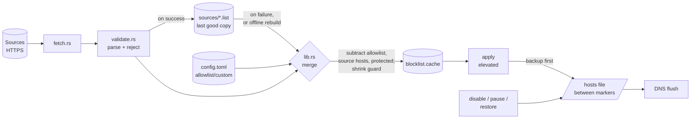

# Architecture

`adblocker` is a single Rust crate (library + binary) that blocks ads
system-wide on macOS, Windows, and Linux by managing the hosts file. It
downloads public blocklists, validates them, and writes the domains between
markers so they resolve to `0.0.0.0`. No GUI, no background services — just
a binary and a Justfile.

## Overview

The tool splits work into two privilege levels:

- **User level: `update`, `status`, `check`, `list`, `allow`/`unallow`,
  `block`/`unblock`.** `update` downloads sources, parses and validates them,
  merges in your custom blocks, subtracts your allowlist, the source hosts,
  and the built-in protected domains, and writes the result to a cache in the
  per-user app directory. It also keeps the last good copy of each source
  (`sources/*.list`), so the list-editing commands can rebuild the cache
  offline. No root needed.
- **Privileged: `apply`, `disable`, `pause`, `restore`, `uninstall --yes`.**
  These need root (macOS/Linux) or Administrator (Windows) because they write
  the hosts file. They read the cache or the existing markers and rewrite the
  hosts file atomically, preserving everything outside the markers and taking
  a backup first.

This separation means the network-facing, CPU-heavy work never needs elevated
privileges, and the privileged path is small and easy to audit.

## Module map

Each module has one job.

| Module | Responsibility |
| --- | --- |
| `error.rs` | `AdBlockerError` (thiserror) enum + `Result` alias. The single error type for the whole library. |
| `validate.rs` | Parse hosts-file lines into domains. `normalize_domain` enforces RFC-ish rules; `parse_hosts_text` accepts only `0.0.0.0`/`127.0.0.1` + valid domain and counts rejections. Holds the built-in `PROTECTED_DOMAINS` list; `is_same_or_subdomain` gives protected entries and allowlist entries their "and every subdomain" meaning. |
| `fetch.rs` | Download a source over HTTPS with a 30 s timeout and a 20 MB body limit (ureq 3.x). |
| `config.rs` | `Paths` (every file location, built once in `main`), `Config` (serde/TOML: sources, allowlist, custom blocks; rejects non-HTTPS sources), the per-OS app directory with its `ADBLOCKER_DIR` override, and reading/writing domain-list files (the cache and per-source snapshots). |
| `hosts.rs` | The marker state machine: read the hosts file into before/markered/after sections (remembering LF vs CRLF), detect broken markers, build new content, write atomically (temp + rename, 0644 on Unix, retried on transient Windows locks), rolling backup, remove the block, flush DNS. Refuses symlinks. |
| `cli.rs` | clap derive definitions (`Cli`, `Command`) plus the `pause` duration parser. |
| `lib.rs` | Public API: the merge algorithm and one function per command. |
| `main.rs` | Thin entry point. Builds `Paths`, dispatches to `lib`, prints results, maps errors to exit codes, installs the Ctrl-C handler for `pause`. The **only** place that references the real hosts file path. |

## Platform differences

All OS-specific code sits as `#[cfg(...)]` variants next to each other; there
is no separate platform module.

| Concern | macOS | Windows | Linux | Where |
| --- | --- | --- | --- | --- |
| Hosts path | `/etc/hosts` | `%SystemRoot%\System32\drivers\etc\hosts` | `/etc/hosts` | `main.rs` `hosts_path` |
| App directory | `~/Library/Application Support/adblocker` | `%APPDATA%\adblocker` | `~/.config/adblocker` (invoking user's, under sudo) | `config.rs` `platform_app_dir` |
| Privilege check | `id -u` is `0` | hosts file opens for append | `id -u` is `0` | `lib.rs` `require_root` |
| DNS flush | `dscacheutil` + `killall -HUP mDNSResponder` | `ipconfig /flushdns` | `resolvectl flush-caches` if present | `hosts.rs` `flush_dns` |
| Line endings | LF | CRLF preserved | LF | `hosts.rs` `HostsSections::crlf` |
| Scheduling | launchd + sudoers (`scripts/`) | Task Scheduler, highest privileges (`scripts/windows/`) | cron (documented, no installer) | — |

## Data flow

- `update`: fetch → validate → merge → shrink guard → snapshots + cache.
- `allow` / `block` / `unallow` / `unblock`: edit config → merge from
  snapshots → cache (no network).
- `apply`: cache → re-validate (drop protected) → backup → hosts file → DNS
  flush.
- `disable`: backup → remove the marked block → DNS flush.
- `pause`: disable, wait, apply.
- `restore`: swap the hosts file with its backup.

## Why only the hosts-file commands need elevation

The dangerous operation is writing the hosts file. Everything else —
fetching over the network, parsing text, set arithmetic, writing files in your
own app directory — is safe at normal-user privilege. Keeping `update`
unprivileged means you can run it from a shell or a scheduler without `sudo`,
and the privileged surface is a handful of commands that do almost nothing
except move a pre-validated cache into the hosts file, remove it, or swap in
the backup. `apply` re-validates the cache before writing and drops protected
domains, so a corrupted or tampered cache can never put anything but
`0.0.0.0 <valid, non-protected domain>` lines into the hosts file.

## Key design decisions & trade-offs

- **Markers, not full-file ownership.** The tool only edits the region between
  `# BEGIN AD-BLOCKER` and `# END AD-BLOCKER`. Your other hosts entries
  survive. Trade-off: we must detect broken markers and refuse rather than
  guess, which `read_hosts` does explicitly. `restore` is the way out when
  something else breaks them.
- **`BTreeSet<String>` for the merge.** Deterministic sorted output (the
  hosts file is reproducible run-to-run), no hashing overhead, and 71 k
  domains is trivially small.
- **Protected list is hardcoded and subtracted last.** Apple and Microsoft
  update, activation and sign-in domains, their subdomains, and every source
  host can never be blocked, even if a source lists them or you add them to
  `custom_blocks`. Trade-off: you cannot un-protect a domain by design.
- **Allowlist entries cover subdomains.** `allow example.com` unblocks
  `ads.example.com` too. That matches what people mean when a site breaks;
  the trade-off is that allowing a broad domain unblocks more than one name.
- **Per-source snapshots.** One flaky source shouldn't stop an update, and
  list edits shouldn't need the network. Snapshots are named by an FNV-1a hash
  of the URL (stable across Rust versions, unlike `DefaultHasher`) and are only
  replaced once a new result passes the shrink guard, so a broken download can
  never become the "last good copy."
- **Shrink guard.** `update` refuses a result under half the size of the
  current cache unless `--force`. Upstream lists break by publishing
  something that still parses; this catches that without any heuristics about
  content.
- **Rolling backup, one step of undo.** The backup is taken before every
  change, so it's never months stale. `restore` swaps the file and the backup,
  so running it twice redoes the change. Trade-off: there is no copy of the
  pristine pre-Lime file once several changes have happened.
- **`pause` runs in the foreground.** No background service or scheduler
  entry is needed; blocking is re-applied when the time is up or when Ctrl-C
  or a closed terminal ends the process (via the `ctrlc` crate's
  `termination` feature). Trade-off: the terminal stays busy while paused.
- **Atomic write via temp + rename.** A crash mid-write never leaves the
  hosts file half-edited. The temp file lives in the same directory, so the
  rename is atomic.
- **DNS flush failure is a warning, not an error.** The hosts file is already
  written when flush runs; reporting a hard error would be misleading.
- **Testable seams.** Every command takes `&Paths`; `update` takes an
  injectable fetcher (`run_update_with`); hosts-file commands have
  `*_no_flush` / `pause_with` variants without the privilege check and DNS
  flush. The integration tests drive whole commands against temp dirs.
- **Few dependencies.** No `libc`/`windows-sys`/`chrono`/`dirs`/`regex`: root
  detection uses `id -u` or a write-permission probe (no `unsafe`, forbidden
  in `Cargo.toml`), "last update" uses file timestamps, and domain validation
  is hand-rolled. `ctrlc` is the one addition, for `pause`.

## How to add a new blocklist source

Add its HTTPS URL to `sources` in `config.toml` (see the platform table above).
The next `adblocker update` will fetch, parse, and merge it. The source must
serve a hosts-format file (lines of `0.0.0.0 domain` or `127.0.0.1 domain`);
anything else is rejected and counted.

## How to add a new command

1. Add a variant to `Command` in `cli.rs`.
2. Add a `run_<name>` function in `lib.rs` taking `&Paths`. If it writes the
   hosts file, put the work in a `<name>_no_flush` function and have
   `run_<name>` add `require_root` and `hosts::flush_dns`.
3. Dispatch it in `main.rs`.
4. Add a Justfile recipe if it should be runnable via `just`.
5. Add an integration test using the `temp_paths` helper.

## Known limitations

- A hosts file cannot block ads served from the same domain as the content
  (e.g. YouTube, many streaming sites). Use it alongside a browser blocker
  such as uBlock Origin.
- Blocking is by exact domain name, not by URL path or wildcard.
- Only `0.0.0.0` and `127.0.0.1` sinkhole targets are honoured; the tool will
  never write a domain pointing to any other IP.
- The protected list is static and covers Apple and Microsoft update,
  activation and sign-in domains; other critical domains are not considered.
- Software that resolves names itself (some VPNs, DNS-over-HTTPS-only browser
  modes) may bypass the hosts file entirely.
