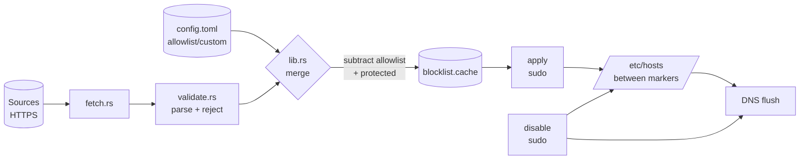

# Architecture

`adblocker` is a single Rust crate (library + binary) that blocks ads
macOS-wide by managing `/etc/hosts`. It downloads a public blocklist,
validates it, and writes the domains between markers so they resolve to
`0.0.0.0`. No GUI, no background services — just a binary and a Justfile.

## Overview

The tool splits work into two privilege levels:

- **`update`** runs as your normal user. It downloads sources, parses and
  validates them, merges in your custom blocks, subtracts your allowlist and
  the built-in protected domains, and writes the result to a cache file under
  `~/Library/Application Support/adblocker/`. No root needed.
- **`apply` / `disable`** need root because they write `/etc/hosts`. They
  read the cache (`apply`) or the existing markers (`disable`) and rewrite
  the hosts file atomically, preserving everything outside the markers.

This separation means the network-facing, CPU-heavy work never needs elevated
privileges, and the privileged path is small and easy to audit.

## Module map

Each module has one job.

| Module | Responsibility |
| --- | --- |
| `error.rs` | `AdBlockerError` (thiserror) enum + `Result` alias. The single error type for the whole library. |
| `validate.rs` | Parse hosts-file lines into domains. `normalize_domain` enforces RFC-ish rules; `parse_hosts_text` accepts only `0.0.0.0`/`127.0.0.1` + valid domain and counts rejections. Holds the built-in `PROTECTED_DOMAINS` list. |
| `fetch.rs` | Download a source over HTTPS with a 30 s timeout and a 20 MB body limit (ureq 3.x). |
| `config.rs` | `Config` (serde/TOML): sources, allowlist, custom blocks. Loads/saves at `~/Library/Application Support/adblocker/config.toml`, creating defaults on first run. Also reads/writes the merged `blocklist.cache`. |
| `hosts.rs` | The marker state machine: read `/etc/hosts` into before/markered/after sections, detect broken markers, build new content, write atomically (temp + rename, 0644), one-time backup, remove the block, flush DNS. Refuses symlinks. |
| `cli.rs` | clap derive definitions (`Cli`, `Command`). No logic. |
| `lib.rs` | Public API: module declarations, the merge algorithm, and `run_*` command functions. |
| `main.rs` | Thin entry point. Parses args, dispatches to `lib`, prints results, maps errors to exit codes. The **only** place that references the real `/etc/hosts`. |

## Data flow

`update` covers `fetch → validate → merge → cache`. `apply` covers
`cache → re-validate → /etc/hosts → DNS flush`. `disable` removes the marked
block and flushes DNS.

## Why `update` is user-level and only `apply` needs sudo

The dangerous operation is writing `/etc/hosts`. Everything else — fetching
over the network, parsing text, set arithmetic, writing a file in your own
Application Support directory — is safe at normal-user privilege. Keeping
`update` unprivileged means you can run it from cron or a shell without
`sudo`, and the privileged surface area is limited to two commands that do
almost nothing except move a pre-validated cache into `/etc/hosts` (or remove
it). `apply` re-validates the cache before writing, so a corrupted cache can
never reach the hosts file.

## Key design decisions & trade-offs

- **Markers, not full-file ownership.** The tool only edits the region between
  `# BEGIN AD-BLOCKER` and `# END AD-BLOCKER`. Your other `/etc/hosts` entries
  survive. Trade-off: we must detect broken markers and refuse rather than
  guess, which `read_hosts` does explicitly.
- **`BTreeSet<String>` for the merge.** Deterministic sorted output (the
  hosts file is reproducible run-to-run), no hashing overhead, and 71 k
  domains is trivially small. Trade-off: slightly slower insert than a
  `HashSet`, irrelevant at this scale.
- **Protected list is hardcoded and subtracted last.** Apple update/activation
  domains and the blocklist source host can never be blocked, even if a source
  lists them or you add them to `custom_blocks`. Trade-off: you cannot
  un-protect a domain by design.
- **Atomic write via temp + rename.** A crash mid-write never leaves
  `/etc/hosts` half-edited. The temp file lives in the same directory
  (`/private/etc`, same filesystem) so `rename` is atomic.
- **DNS flush failure is a warning, not an error.** The hosts file is already
  written when flush runs; reporting a hard error would be misleading. You may
  need to flush manually if `mDNSResponder` is unavailable.
- **`tempfile` is a runtime dependency**, not dev-only, because production
  atomic writes use it.
- **No `libc`/`chrono`/`dirs`/`regex`.** Root detection uses `id -u`; the home
  dir uses `$HOME`; domain validation is hand-rolled character checks; the
  cache header omits a timestamp.

## How to add a new blocklist source

Add its HTTPS URL to `sources` in `~/Library/Application Support/adblocker/config.toml`.
The next `adblocker update` will fetch, parse, and merge it. The source must
serve a hosts-format file (lines of `0.0.0.0 domain` or `127.0.0.1 domain`);
anything else is rejected and counted.

## How to add a new command

1. Add a variant to `Command` in `cli.rs`.
2. Add a `run_<name>` function in `lib.rs` (taking a `&Path` for any hosts
   path so it stays testable).
3. Dispatch it in `main.rs`.
4. Add a Justfile recipe if it should be runnable via `just`.
5. Add tests following the existing pattern (temp files, `_no_flush` variants
   for anything that would otherwise call `flush_dns`).

## Known limitations

- A hosts file cannot block ads served from the same domain as the content
  (e.g. YouTube, many streaming sites). Use it alongside a browser blocker
  such as uBlock Origin.
- Blocking is by domain, not by URL path; it is all-or-nothing per domain.
- Only `0.0.0.0` and `127.0.0.1` sinkhole targets are honoured; the tool will
  never write a domain pointing to any other IP.
- The protected list is static and Apple-focused; other platforms' critical
  domains are not considered.